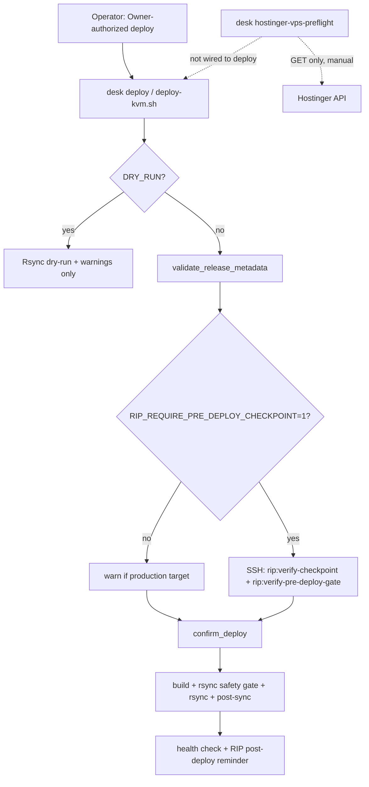
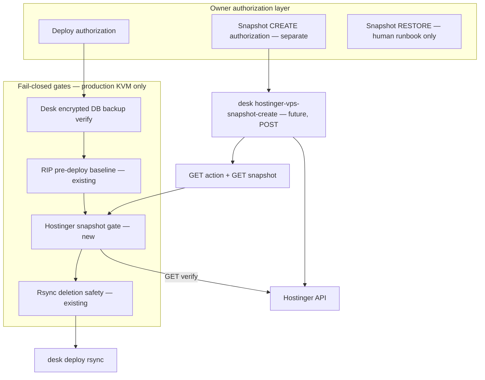

# P-14-16 — Hostinger VPS snapshot deployment-gate design (read-only)

**Global ID:** P-14-16  
**Cursor ledger ID:** RadiumDesk-P-14-16  
**Depends on:** P-14-06, P-14-08, P-14-09, P-14-15  
**Repository:** `github.com/radium-foundation/radium-desk`  
**Design baseline `main`:** `42e92e07e170215aa0ac7b81e234284b2c010bc6`  
**Investigation window:** 2026-11-14 10:27:35 – 10:35:00 IST (UTC+5:30)  
**Elapsed:** ~7.5 minutes (doc review, deploy/RIP tooling, focused unittest harness)  
**Implementation in this task:** **NONE**

---

## Executive summary

Radium Desk already has a **production-baseline RIP gate** on KVM deploy (`RIP_REQUIRE_PRE_DEPLOY_CHECKPOINT`) and a **read-only Hostinger preflight** (`desk hostinger-vps-preflight`, GET only). This design proposes a **separate, fail-closed Hostinger snapshot gate** that layers **whole-VPS recovery intent** on top of RIP and **encrypted Desk DB backups**, without conflating merge, deploy authorization, or API success with recovery readiness.

**Recommendation:** Implement in phases — (1) verify-only gate for Tier A, (2) Owner-authorized snapshot creation workflow with overwrite controls, (3) RIP metadata recording, (4) restore drill off production before claiming restorability.

---

## Verified context (labelled)

| Claim | Label | Evidence |
|-------|--------|----------|
| `virtualMachineId` **1910783** | **VERIFIED** | P-14-08 GET; pinned in `tools/lib/hostinger_vps_preflight.py` |
| Hostname **`srv1910783.hstgr.cloud`** | **VERIFIED** | P-14-08, P-14-15 live smoke |
| Plan **KVM 8**, state **running** | **VERIFIED** | P-14-08 API; preflight output |
| IPv4 **187.127.129.16** | **VERIFIED** | `tools/config.sh`, P-14-08 API |
| Token **`~/.config/hostinger/token`** (0600, off-repo) | **VERIFIED** | P-14-08, P-14-09 |
| User-Agent required (else CF 403) | **VERIFIED** | P-14-08 |
| Single snapshot slot; new create overwrites | **INFERRED** | Hostinger support + OpenAPI (P-14-06); not re-proven by POST in Desk |
| Snapshot **~24h** expiry | **INFERRED** | P-14-08 metadata (~24h span); support article; API `expires_at` is authoritative per capture |
| Restore = whole-disk overwrite | **INFERRED** | Official docs (P-14-06); **no** Desk restore drill |
| Shared KVM (Desk, Box, RDIN, RDNET, RadiumSign, UAT) | **VERIFIED** | P-14-06 / P-03-06 infrastructure discovery |
| Preflight is **GET-only** | **VERIFIED** | `hostinger_vps_preflight.py`; P-14-15 |
| RIP gate optional, default off | **VERIFIED** | `rip-pre-deploy-gate.sh`, `deploy-kvm.sh` |
| RIP manifest schema **v1** has no Hostinger fields | **VERIFIED** | `RipCheckpointManifestValidator.php` required keys |
| Deploy dry-run **skips** RIP production gate | **VERIFIED** | `deploy-kvm.sh` lines 347–348 |
| Snapshot existence ≠ restorability | **VERIFIED** | Policy + P-14-06; P-14-15 preflight only |
| Isolated DB restore rehearsal proven | **UNKNOWN** | No ledger evidence of full isolated restore drill for `radium_desk` |
| Hostinger disk encryption at rest | **INFERRED** | P-14-06: Hostinger does not provide customer-managed encryption for VPS snapshots |

---

## Current deployment architecture (as-is)



**Gap:** No automated linkage between Hostinger snapshot state, deploy tier, and RIP manifest evidence.

---

## Proposed target architecture



Gate **G3** must run **immediately before** rsync (after RIP, before `confirm_deploy` or between confirm and rsync — see race section) and **re-query** snapshot metadata; it must not trust a report from hours earlier.

---

## 1. Deployment classification

Adopt P-14-06 tiering as the Desk KVM taxonomy (no new tier names):

| Tier | Examples | Snapshot gate |
|------|-----------|-----------------|
| **A — High risk** | MariaDB migrations, PHP/runtime/OLS, multi-app impact, Redis/queue infra, Central Wallet / statutory production flags, major cron | **Mandatory** — fail-closed verify; fresh snapshot via **separate Owner auth** unless policy waives create |
| **B — Standard production** | Tagged Desk release via `deskd`, overlay deploy affecting production paths | **Mandatory verify** of an **acceptable** snapshot (fresh create recommended same day; see freshness) |
| **C — Low risk** | Single-file overlay, config cache, no DB migration | **No Hostinger gate** — preserve current behavior (RIP warning-only, DB backup discipline) |

**Tier assignment:** Operator declares `DEPLOY_TIER=A|B|C` (env or `desk deploy --tier`) with **immutable ledger line** for each production deploy. Gate script **refuses** missing tier on canonical KVM target when `HOSTINGER_SNAPSHOT_GATE=1`.

**Preserve lower-risk behavior:** Default `HOSTINGER_SNAPSHOT_GATE=0` until Owner enables; Tier C never requires Hostinger API.

**Owner decision (required):** Tier B — verify-only acceptable vs mandatory fresh create before every B deploy.

---

## 2. Snapshot lifecycle

### 2.1 Identity verification (every gate run)

1. `GET /api/vps/v1/virtual-machines` → single VM or find id **1910783**.
2. Assert hostname ∈ {`srv1910783.hstgr.cloud`, prefix `srv1910783`} — same rules as preflight.
3. `GET .../virtual-machines/1910783` → assert `id`, hostname, `ipv4` contains **187.127.129.16**, `state` = `running`, `plan` = **KVM 8** (API string).
4. Any mismatch → **ABORT** (fail-closed).

### 2.2 Freshness and expiry

| Mode | Requirement |
|------|----------------|
| **Verify existing** | `GET .../snapshot` → 200; `expires_at` > now + **safety_margin** (proposed **30m**); `created_at` ≥ **deploy_authorization_time** OR matches `HOSTINGER_SNAPSHOT_GATE_ID` recorded in ledger |
| **After create** | Poll action to `success`; then GET snapshot; record `id`, `created_at`, `expires_at` |
| **404 / expired** | **ABORT** for Tier A/B when gate enabled |

Treat support-doc **~24h** as operational planning; **gate uses API `expires_at`**.

### 2.3 Prevent silent overwrite

Before any **POST create** (future command):

1. `GET .../snapshot` — if 200 and `expires_at` still valid:
   - **Default ABORT** with message listing `id`, `created_at`, `expires_at`.
   - Allow overwrite only with **`HOSTINGER_SNAPSHOT_OVERWRITE_OWNER=1`** plus ledger id referencing explicit Owner approval (not `deploy --yes`).
2. Write **pre-create audit record** (ledger + optional sidecar JSON) with prior snapshot id.
3. POST create → store **action id**; poll until terminal state.

### 2.4 Occupied slot during deploy-only verify

If policy is verify-only (no create in this session):

- Require env `HOSTINGER_SNAPSHOT_GATE_ID=<snapshot id>` matching GET body.
- If GET id ≠ expected → **ABORT** (race or overwrite detected).
- If occupied by **foreign** snapshot (created before deploy auth window without Owner overwrite approval) → **ABORT**.

### 2.5 RIP metadata recording

**Do not** mutate captured checkpoint artifacts post-hoc. Record Hostinger evidence at **capture time** (pre-RIP) or in a **new** checkpoint revision.

Proposed **manifest.json** extension (`schema_version` **2** or optional block under v1 — requires validator change in implementation phase):

```json
"hostinger_vps_snapshot": {
  "vm_id": 1910783,
  "hostname": "srv1910783.hstgr.cloud",
  "ipv4": "187.127.129.16",
  "plan": "KVM 8",
  "gate_mode": "verify_existing | created_for_deploy",
  "snapshot_id": 455368,
  "snapshot_created_at": "2026-11-14T03:40:37Z",
  "snapshot_expires_at": "2026-11-15T03:40:37Z",
  "snapshot_action_id": null,
  "snapshot_action_state": null,
  "verified_at_utc": "2026-11-14T04:55:00Z",
  "deploy_tier": "A",
  "deploy_authorization_ledger_id": "RadiumDesk-P-xx-yy",
  "source_production_build": "42e92e07",
  "api_checkout_correlation_id": "uuid-v4",
  "overwrite_prior_snapshot_id": null
}
```

Parallel **operator ledger row** must duplicate snapshot id + expiry + correlation id (RIP tar may omit API secrets).

**Source commit:** `source_production_build` = live `release.json` `build` at gate time (7-char), same semantics as RIP production baseline — **not** the commit about to be deployed.

---

## 3. Fail-closed deployment gate

### Preconditions (all required when `HOSTINGER_SNAPSHOT_GATE=1` and tier A/B)

1. Canonical KVM production target (`rip_is_verified_kvm_production_deploy_target`).
2. Valid tier declaration A or B.
3. Desk encrypted DB backup success verified per runbook (existing manifest / cloud inventory) — **separate check**, still required.
4. RIP gate passed if `RIP_REQUIRE_PRE_DEPLOY_CHECKPOINT=1`.
5. Hostinger identity GETs succeed; snapshot policy satisfied (§2).
6. `actions_lock` = **`unlocked`** on VM detail (if `locked` → wait with bounded timeout, then **ABORT**).

### Abort conditions

Any failed precondition; ambiguous API response; snapshot id mismatch; expiry inside margin; concurrent deploy lock held.

### API failure matrix

| Condition | Behavior |
|-----------|----------|
| Timeout (proposed 60s per request, 10m create poll) | **ABORT** |
| HTTP **403** | **ABORT**; hint UA / token scope (no token in logs) |
| HTTP **429** | **ABORT** after bounded backoff respecting `Retry-After` (max 3 attempts) |
| Malformed JSON | **ABORT** |
| HTTP 5xx | **ABORT** (no deploy) |
| Identity mismatch | **ABORT** |
| Snapshot 404 when required | **ABORT** |
| `actions_lock: locked` past timeout | **ABORT** |

### Race: preflight vs deploy

| Risk | Mitigation |
|------|------------|
| Stale manual preflight | Deploy gate **never** reads saved JSON; always live GET |
| Snapshot overwritten between check and rsync | Re-run full gate **immediately before** rsync; optional **deploy mutex** file on operator machine |
| Two operators | Single-flight lock `~/.cache/radium-desk/kvm-deploy.lock` + Hostinger `actions_lock` check |
| Time drift | Use UTC; compare `expires_at` from API |

Proposed order in `deploy-kvm.sh` (implementation):  
`rip_verify` → **`hostinger_snapshot_gate_verify`** → `confirm_deploy` → build → **`hostinger_snapshot_gate_reverify`** (lightweight: snapshot id + lock only) → rsync safety.

---

## 4. Owner authorization

| Action | Authorization |
|--------|----------------|
| Production **deploy** | Existing Owner / release process — **unchanged** |
| **Snapshot POST create** | **Separate** explicit Owner authorization (`HOSTINGER_SNAPSHOT_CREATE_OWNER=<ledger id>`) — **never** implied by deploy or merge |
| **Snapshot restore** | **Human-controlled** maintenance window; hPanel/API restore **out of desk deploy** |
| **Overwrite valid snapshot** | Separate flag + ledger id |
| **Enable gate globally** | Owner: `HOSTINGER_SNAPSHOT_GATE=1` default for production |

Successful API response or CI merge **does not** authorize create or restore.

---

## 5. Shared-server impact

| Topic | Assessment |
|-------|------------|
| Blast radius | Snapshot create/restore affects **entire KVM** — all vhosts, all MariaDB instances, Redis, cron |
| Maintenance | Tier A/B deploys with create: expect **actions_lock**; brief I/O; coordinate comms if multi-app downtime risk |
| Communication | Ledger + team channel template: snapshot id, expiry, apps affected |
| Privacy / encryption | Snapshots include all disk data (all sites, keys on disk, backups); **not** customer-managed encrypted at rest per P-14-06 — treat as **sensitive**, restrict API token to Owner/operators |
| Token permissions | Read for verify; broader scope only on operator Mac for create — **never** CI write token without isolation |

---

## 6. Recovery integrity

| Layer | Role |
|-------|------|
| **Hostinger snapshot** | Whole-VM rollback **intent** (~24h window) |
| **Hostinger automated backups** | Longer retention; restore still whole-VPS — **not verified** in Desk |
| **Desk encrypted DB backup** | Authoritative **financial / desk data** recovery — **keep separate** |
| **RIP** | Application code rollback — **not** DB |

**Why snapshot ≠ restorable:** API metadata does not prove restore workflow, disk consistency under load, or MariaDB crash consistency.

**Restore drill prerequisites (before “recovery ready” claim):**

1. **Non-production** environment (separate Hostinger trial VM or local KVM lab) — **not** `1910783`.
2. Create snapshot → restore → validate SSH, MariaDB start, single app smoke.
3. **Isolated `radium_desk` DB restore** from encrypted backup into disposable MariaDB — prove CA/finance queries — **orthogonal** to VPS snapshot drill.
4. Document RTO/RPO actuals; Owner sign-off in ledger.

P-14-15 **does not** satisfy drill requirements.

---

## 7. Testing and observability

Per `docs/RADIUMWEBSITES_TESTING_AND_VALIDATION_POLICY.md`: **focused** tests only; no full PHPUnit for this design.

| Layer | Strategy |
|-------|----------|
| **Unit** | Mock `urllib` / inject opener: 403, 429, malformed JSON, hostname mismatch, expiry edge, id mismatch |
| **Shell gate** | Similar to `rip-pre-deploy-gate.test.sh`: tier env, abort paths, no POST in static grep |
| **Integration** | Opt-in live GET job on operator Mac (not CI) using existing preflight |
| **Failure-mode** | Simulated locked VM, 404 snapshot, expired `expires_at` |
| **Concurrency** | Two processes contending for deploy lock; gate idempotency |
| **Snapshot slot race** | Test: GET returns id A, second GET returns id B → second gate fails |

**Audit logging:** Structured stderr/ledger fields: `vm_id`, `snapshot_id`, `http_status`, `rate_limit_remaining`, `correlation_id`, `checked_at_utc`. **Never** log bearer token or full `Authorization` header.

**Observability:** Append one line per gate run to Cursor ledger for production deploys (even on failure).

---

## Risk register

| ID | Risk | Sev | Mitigation |
|----|------|-----|------------|
| R1 | Whole-VPS restore harms sister apps | **Critical** | Owner-only restore; comms; tiering |
| R2 | Silent snapshot overwrite | **High** | Pre-POST GET + Owner overwrite flag |
| R3 | 24h expiry < deploy delay | **High** | Re-verify expiry; abort if inside margin |
| R4 | False confidence from GET | **High** | Restore drill off prod; DB layer separate |
| R5 | Token leak via logs/RIP | **High** | Redaction, off-repo token, no CI secret |
| R6 | CF 403 without UA | **Medium** | Pin UA in all clients |
| R7 | `actions_lock` mid-deploy | **Medium** | Poll + abort |
| R8 | Operator tier mis-label | **Medium** | Ledger + mandatory env |
| R9 | Race between operators | **Medium** | Deploy mutex + snapshot id pin |
| R10 | Encrypted backup stale | **High** | Keep existing DB backup gate |

---

## API operations and authorization boundaries

| Operation | Method | In deploy automation? | Owner auth |
|-----------|--------|----------------------|------------|
| List VMs | GET | Verify gate | — |
| VM details | GET | Verify gate | — |
| Get snapshot | GET | Verify gate | — |
| List backups | GET | Optional advisory | — |
| Create snapshot | POST | **Separate command only** | **Required** |
| Poll action | GET | After POST only | **Required** |
| Restore snapshot | POST | **Never** | Human runbook |
| Delete snapshot | DELETE | **Never** | Human |

---

## Failure / abort matrix (summary)

See §3 API table + §2 lifecycle. Deploy exit code **non-zero**; no partial rsync when gate fails after confirm (reverify before rsync prevents late failure after build — accept wasted build vs safety).

---

## Explicit Owner approval decisions

1. Enable `HOSTINGER_SNAPSHOT_GATE` for production (default on vs opt-in).
2. Tier B: verify-only vs mandatory create.
3. Freshness margins (`safety_margin`, max snapshot age without recreate).
4. Overwrite policy when valid snapshot exists.
5. Whether to bump RIP `schema_version` vs sidecar file for Hostinger fields.
6. Schedule funding/time for **off-production restore drill**.
7. Separate API token for create vs read-only verify.
8. Customer communication template for multi-app maintenance.

---

## Recommended implementation phases

| Phase | Deliverable | Mutating API? |
|-------|-------------|---------------|
| **P-14-17** | `hostinger_snapshot_gate_verify.sh` + deploy hook (GET only) + tests | No |
| **P-14-18** | Tier env + ledger templates + docs in `release-workflow.md` | No |
| **P-14-19** | Owner-authorized `hostinger-vps-snapshot-create` + action poll + overwrite guards | POST only with auth |
| **P-14-20** | RIP manifest schema v2 + capture hook records snapshot block | No |
| **P-14-21** | Off-prod restore drill + DB isolated drill report | Human / lab only |

---

## Prohibited actions (this task)

| Action | Status |
|--------|--------|
| Code changes (beyond this doc + ledger) | **NO — Not performed** |
| POST/PUT/PATCH/DELETE Hostinger API | **NO — Not performed** |
| Snapshot create/restore/delete | **NO — Not performed** |
| Production deploy / data changes | **NO — Not performed** |
| VPS restart/lock | **NO — Not performed** |
| Token create/rotate | **NO — Not performed** |
| Commit / push / merge | **NO — Not performed** |
| Wallet branch touch | **NO — Not performed** |

---

## Checks (this task)

| Check | Status |
|-------|--------|
| Repo `main` @ `42e92e07` | **PASSED** |
| Worktree clean except untracked `P-14-10` doc / `__pycache__` | **PASSED** |
| P-14-06/08/09/15 + RIP/deploy docs reviewed | **PASSED** |
| `hostinger_vps_preflight.py` GET-only review | **PASSED** |
| `deploy-kvm.sh` + `rip-pre-deploy-gate.sh` review | **PASSED** |
| Focused `hostinger-vps-preflight.test.sh` | **PASSED** (~1s, 15/15) |
| Live Hostinger GET smoke | **NOT RUN** (not required for design) |
| Full PHPUnit / deploy dry-run | **NOT RUN** (per policy / scope) |