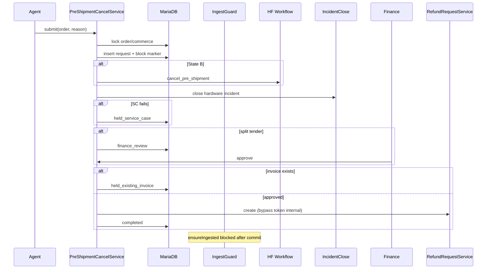

# P-22-29 — Phase 2 State A+B implementation specification (hardware pre-shipment cancellation)

**Status:** Owner-approved specification — **does not authorize code, migrations, or deploy**  
**Scope:** **State A** (paid hardware, no `hardware_fulfilments` row) and **State B** (HF open, **before** `serials_allocated` / statutory invoice)  
**Order families:** **RBP**, **RDE**, **RDP** (`BusinessOrderId` — **VERIFIED** `app/Support/BusinessOrderId.php`)  
**Parent design:** [`desk-p22-28-hardware-preship-cancel-design.md`](desk-p22-28-hardware-preship-cancel-design.md)  
**Code baseline:** `origin/main` @ **`fc90e304f`** (post P-22-28 doc merge)  
**Cursor ledger ID:** `bd0ac5bd-88f0-48e0-aacd-66eca9be9aef`  
**Clean-room:** port **concepts/tests** from `.worktrees/p1711-preship-cancel/desk` only; **never** merge that worktree.

**Excluded from this spec:** State C/D, serial release, statutory orchestrator execution, AWB, Shiprocket, Phase 3.

---

## 0. Owner decisions (recorded 2026-11-22)

| # | Decision | Status |
|---|----------|--------|
| 1 | Tax outcome **before** refund completion when a statutory invoice exists; no auto tax path | **APPROVED** |
| 2 | Split-tender → **manual Finance** in Phase 2; show Cashfree + Wallet breakdown; no `payment_amount`-only math | **APPROVED** |
| 3 | Auto transition/cancel **hardware-routed** ServiceCase (`Incident`) on committed cancellation + immutable audit | **APPROVED** |
| 4 | Desk-owned durable cancellation record; block all HF ingest/recovery paths; **no** spoke writes in Phase 2 | **APPROVED** |
| 5 | **Clean-room** on current `main`; selective port from p1711 | **APPROVED** |
| 6 | Phase 3 Shiprocket **DEFERRED** until Phase 2 known-good | **APPROVED** |

---

## A. Data and schema plan (proposed — **not executed**)

### A.1 Table: `pre_shipment_cancellation_requests`

| Column | Type / notes |
|--------|----------------|
| `id` | bigint PK |
| `reference_no` | string unique (human ref, e.g. `PSC-YYYYMMDD-NNNN`) |
| `order_id` | FK → `orders.id` (support/desk order) |
| `commerce_order_id` | nullable FK → `commerce_orders.id` |
| `hardware_fulfilment_id` | nullable FK → `hardware_fulfilments.id` (State B) |
| `source_id` | string indexed (`RBP*`/`RDE*`/`RDP*`) |
| `order_family` | enum string: `rbp` \| `rde` \| `rdp` |
| `phase_scope` | string default `phase2_ab` |
| `status` | enum (see §A.2) |
| `sub_status` | nullable string (recovery hint) |
| `blocker_reason` | agent-selected reason code |
| `cancellation_reason` | text (operator) |
| `submitted_by_user_id` | FK users |
| `reviewed_by_user_id` | nullable FK |
| `finance_completed_by_user_id` | nullable FK |
| `shipment_verification` | enum: `confirmed_unshipped` \| `unknown_held` (desk-only; no carrier API) |
| `order_total_amount` | decimal(12,2) snapshot |
| `wallet_tender_amount` | nullable decimal |
| `external_tender_amount` | nullable decimal (Cashfree leg) |
| `already_refunded_amount` | decimal snapshot |
| `maximum_refundable_amount` | decimal snapshot |
| `requested_refund_amount` | decimal |
| `split_tender` | boolean |
| `execution_hold` | boolean (true when split-tender) |
| `execution_hold_reason` | nullable text |
| `refund_request_id` | nullable FK → `refund_requests.id` |
| `recorded_tax_statutory_invoice_id` | nullable FK (if invoice found in A/B — rare) |
| `recorded_tax_outcome_type` | nullable enum: `cancellation` \| `credit_note` \| `not_applicable` |
| `service_case_incident_id` | nullable FK → `incidents.id` |
| `service_case_outcome` | nullable json (close audit snapshot) |
| `service_case_sync_status` | enum: `pending` \| `succeeded` \| `failed` \| `not_applicable` |
| `idempotency_key` | string unique (client replay) |
| `ingestion_block_version` | int (increment on commit for optimistic checks) |
| `committed_at` | nullable timestamp (fulfilment block active) |
| `terminal_at` | nullable timestamp |
| `future_spoke_sync_status` | nullable string — **reserved**, no Phase 2 writer |
| `future_spoke_sync_payload` | nullable json — **reserved** |
| timestamps | `created_at`, `updated_at` |

**Soft-delete:** **Avoid.** Terminal rows are retained for audit (align with refund/return cases). Use status `rejected` / `superseded` instead of delete.

### A.2 Lifecycle statuses (Phase 2 A+B)

| Status | Meaning |
|--------|---------|
| `draft` | optional future; Phase 2 may start at `submitted` |
| `submitted` | agent intent captured |
| `held_shipment_unknown` | ambiguous HF correlation (fail-closed) |
| `held_existing_invoice` | unexpected issued invoice — Finance/CA (**no auto tax**) |
| `held_execution` | refund linkage/repair |
| `held_service_case` | incident close failed — retry queue |
| `finance_review` | split-tender or policy hold |
| `finance_approved` | ready for refund **request** creation only |
| `refund_request_linked` | `RefundRequest` id set; not necessarily executed |
| `completed` | terminal success (A: block ingested; B: HF stopped; case synced or `not_applicable`) |
| `rejected` | terminal denial |
| `superseded` | duplicate idempotency replay → prior row |

**Intermediate states must be visible in UI** — no silent `completed` while `held_*` work remains.

### A.3 Indexes and uniqueness

- **Unique:** `reference_no`, `idempotency_key`
- **Partial unique (application-enforced + optional DB):** at most one **open** case per `order_id` where status ∉ terminal set
- **Indexes:** `(source_id)`, `(commerce_order_id)`, `(hardware_fulfilment_id)`, `(status, created_at)`

### A.4 Companion: `commerce_order_cancellation_blocks` (optional normalized guard)

If normalized guard is preferred over JSON on commerce row:

| Column | Purpose |
|--------|---------|
| `commerce_order_id` | unique FK |
| `pre_shipment_cancellation_request_id` | FK |
| `active` | boolean |
| `blocked_at` | timestamp |

**Either** block table **or** boolean `commerce_orders.hardware_fulfilment_blocked_at` + FK — implementer chooses; spec requires **single authoritative lookup** used by all ingest paths.

### A.5 Migration ordering and rollback

1. Create `pre_shipment_cancellation_requests` (no FK to refunds until table exists).
2. Add nullable FKs / block marker on `commerce_orders` if used.
3. **No** changes to `hardware_fulfilments` enum until implement PR (proposed terminal: `cancelled_pre_shipment` — **State B only** in later commit within same feature branch).

**Rollback:** `down()` drops new tables/columns only; **no** data repair in `down()`. Production rollback requires Owner runbook if rows exist.

**Integrity checks post-migrate:** FK existence; no orphan `hardware_fulfilment_id`; unique open-case constraint smoke query.

---

## B. Ingestion and fulfilment prevention

### B.1 Interception points (**VERIFIED** call graph)

| Entry | Method | File |
|-------|--------|------|
| Channel ingest | `ensureIngested` | `HardwareFulfilmentFoundationService.php` |
| Recovered commerce | `ensureIngestedFromExistingCommerce` | same |
| RBP gap recovery | `ensureIngestedFromExistingCommerceForRbpGapRecovery` | same |
| Isolated workflow | `ensureIngestedFromExistingCommerce` via `HardwareFulfilmentIsolatedWorkflowService` | |
| Ingest wrapper | `ChannelIngestService` (3 call sites) | |

**Required guard (new):** `HardwareFulfilmentCancellationGuard::assertFulfilmentNotBlocked(CommerceOrder $order): void`

Call **first line** inside:

- `ensureIngested` (after fresh order, before create)
- `openHardwareFulfilmentFromExistingCommerce` (before existing lookup / create)
- `RbpHardwareFulfilmentGapRecoveryService` before `ensureIngestedFromExistingCommerceForRbpGapRecovery` (**VERIFIED** already skips `commerceOrderVoidsFulfilment` — extend with Desk block)

### B.2 Classifiers and monitors (read paths that must respect block)

| Component | Action |
|-----------|--------|
| `RbpHardwareFulfilmentGapMonitor::findGaps` | Exclude commerce with active cancellation block (**VERIFIED** monitor today skips voided metadata only) |
| `HardwareNeedsActionSqlQuery` / awaiting fulfilment KPIs | Exclude blocked / cancelled HF terminal state |
| `desk:recover-rbp-hardware-fulfilment-gaps` | Fail-closed when block active (**VERIFIED** command → `RbpHardwareFulfilmentGapRecoveryService`) |
| `HardwareOwnerAuthorizedExistingCommerceGate` | Treat active Desk cancellation like voided metadata for authorization |

### B.3 Locking and races

**Commit cancellation block (State A):**

1. `lockForUpdate` `orders` → resolve `commerce_orders`
2. `lockForUpdate` `commerce_orders`
3. Insert `pre_shipment_cancellation_requests` + activate block marker **in same transaction**
4. Re-check: no HF row; if HF appeared → transition to State B handler branch (abort A-only path)

**Race: cancellation vs `ensureIngested`:**

- HF create path must `lockForUpdate` commerce row (or block row) before insert
- Unique `commerce_order_id` on `hardware_fulfilments` (**VERIFIED** existing) + guard → second writer fails into reconciliation

**Reconciliation command (implement later):** `desk:reconcile-preship-cancel-vs-fulfilment` — lists HF created after `committed_at` without matching cancel state → alert only in Phase 2 A+B.

### B.4 State A durable behavior

After `committed_at`:

- `ensureIngested*` throws `ValidationException` with code `hardware_fulfilment_blocked_preship_cancel`
- Gap monitor does not surface order as gap
- **No** outbound spoke metadata write (Owner decision 4)

### B.5 State B — HF stop (no serials)

Eligible HF states (**VERIFIED** enum): `ingested`, `ready_for_fulfilment`, optionally `paid` if present.

**Transition:** workflow service → new terminal `cancelled_pre_shipment` (proposed enum value) with event payload linking `pre_shipment_cancellation_request_id`.

**Must not** run in Phase 2 A+B spec: `StatutoryInvoiceCancellationOrchestrator`, serial release, shipment mutation.

If HF already `serials_allocated` or beyond → **reject** at submit (defer to future State C spec).

---

## C. ServiceCase (Incident) lifecycle

### C.1 Identification (**VERIFIED**)

- Hardware routing uses **`Incident`** linked to **`orders.id`** via `incidents.order_id` (`HardwareOrderServiceCaseAssignmentCoordinator`)
- Hardware order ids: `Order::isHardwareOrderId` / `BusinessOrderId::isHardwareByPrefix` for **RBP/RDE/RDP**
- **Do not close** incidents unrelated to the commerce `support_order_id` or without hardware-routing evidence

**Selection algorithm (proposed):**

1. Primary: `Incident::where('order_id', $supportOrderId)->where('status', '!=', 'closed')->orderBy('id')` — same as `retryAfterFulfilmentIngest` (**VERIFIED**)
2. Require: `HardwareOrderServiceCaseAssignmentCoordinator::isAwaitingInternalSerialAllocation($order)` **OR** audit event `service_case.hardware_routing_deferred` / hardware assignment present
3. If multiple open incidents → **fail-closed** `held_service_case` + manual ops

### C.2 Authorized transition

On cancellation **commit** (same transaction as HF block / HF terminal transition):

1. Close incident via existing close pathway (e.g. `WorkspaceCloseActionService` / refund-case close patterns — **INFERRED** exact method to be chosen at implement time) with reason enum **`hardware_preship_cancellation`**
2. Append **immutable** `audit_logs` row:

```json
{
  "event": "service_case.hardware_preship_cancelled",
  "pre_shipment_cancellation_request_id": 123,
  "actor_user_id": 1,
  "reason": "...",
  "source_id": "RBPxxxx",
  "incident_id": 456,
  "committed_at": "ISO8601"
}
```

### C.3 Failure and retry

- If incident close fails: case → `held_service_case`; **do not** mark `completed`
- Outbox job `preship-cancel-close-incident` with idempotency `psc-incident:{request_id}`
- Repair: operator retry or support command; incident status must match cancellation row in queries

### C.4 Queue visibility

- Exclude `cancelled_pre_shipment` HF and blocked commerce from **awaiting serial** / **needs action** SQL (**VERIFIED** sources: `HardwareNeedsActionSqlQuery`, dashboard chunk resolvers)

---

## D. Authorization and permissions

### D.1 Proposed permissions (new seeder entries)

| Permission | Allows |
|------------|--------|
| `preship_cancellations.submit` | Agent create/submit (hardware team + admin) |
| `preship_cancellations.view` | View own/branch cases |
| `preship_cancellations.central` | Cross-branch queue (Finance/ops admin) |
| `preship_cancellations.review` | Finance review split-tender / holds |
| `preship_cancellations.approve` | Finance approve → link refund request |
| `preship_cancellations.reject` | Finance/agent reject |

Mirror **ReturnExchange** separation (`returns.cases.*` — **VERIFIED** `RolePermissionSeeder`).

### D.2 Policies

- Policy checks: order ownership/visibility (support order), hardware prefix, paid status
- CSRF on all POST; `authorize()` on controllers
- **No** admin bypass without permission

### D.3 `HardwareOrderRefundCaseGate` and bypass tokens

Phase 2 A+B **only** uses:

- `BYPASS_PRE_SHIPMENT_CANCELLATION` when `RefundRequestService::create` is invoked **from** `PreShipmentCancellationRefundLinkService` **after** Finance approval and only if:

  1. Linked `pre_shipment_cancellation_requests.id` matches
  2. Case status ∈ `{finance_approved, refund_request_linked}`
  3. Tax outcome recorded if invoice exists (see §E)
  4. Bypass token passed as **internal** argument — **not** HTTP-exposed

**Why not a general bypass:** Gate remains default-deny for hardware product orders (**VERIFIED**); bypass is **narrow**, service-mediated, and audited. HTTP clients cannot supply token.

### D.4 Split-tender

- `execution_hold=true` → status `finance_review` until Finance approval (port concept from p1711 `PreShipmentTenderRefundability` — **VERIFIED** in WIP)

---

## E. Refund and wallet boundaries (Phase 2 A+B)

### E.1 Amount calculation (clean-room port)

Introduce **`OrderPaymentBreakdownResolver`** (p1711 concept — **not on main**):

| Field | Source priority |
|-------|-----------------|
| `order_total` | `commerce_orders.order_value` → breakdown → fail hold |
| `wallet_tender` | `commerce_orders.wallet_tender_amount` / breakdown |
| `external_tender` | Cashfree-correlated payment evidence — **not** `orders.payment_amount` alone (**VERIFIED** RBP858) |
| `already_refunded` | `RefundCalculationService` |
| `maximum_refundable` | `order_total - already_refunded` (0.01 tolerance) |

### E.2 Split-tender rule

If `wallet_tender > 0` **and** `external_tender > 0` → `split_tender=true`, `execution_hold=true`, **no** automatic refund execution in Phase 2 A+B — Finance manual allocation (UI shows breakdown).

### E.3 Central Wallet RELEASE vs Credit

| Phase | Semantics | Phase 2 A+B |
|-------|-----------|-------------|
| **RELEASE** | Pre-settlement reservation undo on spoke | **Document only** — no executor in A+B unless Owner later authorizes; config flag default **false** (p1711 pattern) |
| **Credit** | Post-commit refund via `WalletRefundExecutor` / desk-first ledger | **Out of scope for State A+B spec** except **RefundRequest** creation link — **no** `complete()` in same user action |

### E.4 Tax before refund

Before `RefundRequestService::create`:

1. `OrderStatutoryInvoiceResolver::resolveForOrder` (**VERIFIED**)
2. If **issued** invoice found in State A/B (unexpected): status → `held_existing_invoice`; require Finance manual tax outcome recorded on case (mirror `ReturnExchangeCaseRecordedTaxOutcomeVerifier` pattern — **VERIFIED**); **no** automatic orchestrator call in Phase 2 A+B
3. If no issued invoice: `not_applicable`

**Refund completion** (`refunds.execute`) remains blocked until tax fields set when invoice exists (application check on approve step).

### E.5 Duplicate protection

- Unique open case per order
- `RefundRequest` link idempotent: second approve returns existing `refund_request_id`

---

## F. State transitions and recovery

### F.1 Ordered transition table (Phase 2 A+B)

| Step | State A | State B | Lock order |
|------|---------|---------|------------|
| T0 | Eligibility check (paid, RBP/RDE/RDP, no AWB) | + HF pre-serial | read |
| T1 | `submitted` insert | same | order → commerce |
| T2 | `committed_at` + ingestion block | + HF → `cancelled_pre_shipment` | commerce → HF |
| T3 | ServiceCase close | same | incident |
| T4 | Tax check | same | — |
| T5 | `finance_review` if split | same | — |
| T6 | `finance_approved` | same | — |
| T7 | `refund_request_linked` | same | refund row |
| T8 | `completed` | same | terminal |

**AWB check:** `shipment_id` / `awb` / states ≥ `awb_assigned` → **reject** (Phase 3 boundary — port `PreShipmentFulfilmentShipmentVerifier` concept, **VERIFIED** p1711).

### F.2 Sequence diagram (Mermaid)



### F.3 Idempotency keys

| Operation | Key pattern |
|-----------|-------------|
| Submit | `psc-submit:{order_id}:{sha256(actor+reason)}` or client header |
| Incident close | `psc-incident:{request_id}` |
| Refund link | `psc-refund:{request_id}` |

### F.4 Failure states (operator visible)

| Failure | Status | Recovery |
|---------|--------|----------|
| HF race on State A | `held_execution` | Reconcile HF + branch B or abort |
| Incident close fail | `held_service_case` | Retry job |
| Unexpected invoice | `held_existing_invoice` | Finance tax + resume |
| Split-tender auto attempted | prevented | `finance_review` only |

**Transaction boundaries:** T2+T3 may be one transaction; incident close failure rolls back **or** moves to `held_service_case` with block already committed — implementer must choose **fail-forward** with `held_service_case` (recommended: block + HF cancel committed; incident retried async).

---

## G. Test matrix (implement in future PRs — **not run in P-22-29**)

| ID | Scenario | Layer | Evidence |
|----|----------|-------|----------|
| T1 | Cancel before HF → channel ingest blocked | Feature | extend `HardwareRbpFulfilmentRegressionTest` pattern |
| T2 | Cancel races `ensureIngested` | Concurrency | InnoDB two-connection |
| T3 | Duplicate submit | Feature | unique constraint |
| T4 | State B HF ingested → cancel → terminal state | Feature | workflow unit |
| T5 | Incident close failure → `held_service_case` | Feature | mock close |
| T6 | Duplicate RefundRequest link | Feature | idempotent approve |
| T7 | Split-tender → `finance_review`, no auto execute | Unit | breakdown resolver |
| T8 | Cashfree-only amount cap | Unit | commerce + payment_amount |
| T9 | Wallet-only cap | Unit | wallet_tender |
| T10 | RELEASE not called when flag false | Unit | config |
| T11 | Invoice present in A/B → hold, no refund | Feature | resolver mock |
| T12 | Process kill after commit → block survives | Integration | reload |
| T13 | Unauthorized submit | Feature | policy 403 |
| T14 | HTTP bypass token rejected | Feature | gate |
| T15 | No Shiprocket client calls | Unit | fake gateway assert 0 |
| T16 | Gap monitor excludes blocked | Unit | monitor |
| T17 | Gap recovery command blocked | Feature | recovery service |

**Port from p1711:** shipment verifier tests, tender refundability cases — rewrite against clean-room classes.

---

## H. P-17-11 provenance (selective port)

| p1711 artifact | Port? | Notes |
|----------------|-------|-------|
| `PreShipmentFulfilmentShipmentVerifier` | **Yes** — concept | AWB boundary |
| `PreShipmentTenderRefundability` | **Yes** | Split-tender hold |
| `OrderPaymentBreakdownResolver` | **Yes** | Required on main |
| `PreShipmentCancellationRequestService` submit | **Partial** | Add guard + incident + no wallet auto |
| `PreShipmentAutomaticWalletCreditService` | **No** in Phase 2 A+B | Owner manual Finance |
| Migrations | **Rewrite** timestamps/FKs for `main` | |
| Feature tests (5 files) | **Rewrite** namespaces | |

Git ref `feature/p17-11-preship-cancel` @ `905cdda76` has **zero** delta from ancestor — **VERIFIED**; only p1711 worktree holds code.

---

## I. Implementation prerequisites (gated)

1. Owner sign-off **this spec** (P-22-29)  
2. Separate **`P-22-30` (or equivalent) authorization** for application code + migrations  
3. Permission names + UI routes approved  
4. MariaDB migration rehearsal (P-18-3 lesson)  
5. Phase 2 deploy → smoke → protected journey → **known-good** before Phase 3 discussion  

---

## J. Phase 3 boundary (documentation only)

Phase 2 A+B implementation **must not** call `HttpShiprocketGateway::cancelOrders` or create AWB. Orders reaching `awb_assigned` are **rejected** at submit.

---

*End of P-22-29 specification. Application implementation is **not authorized** by this document.*